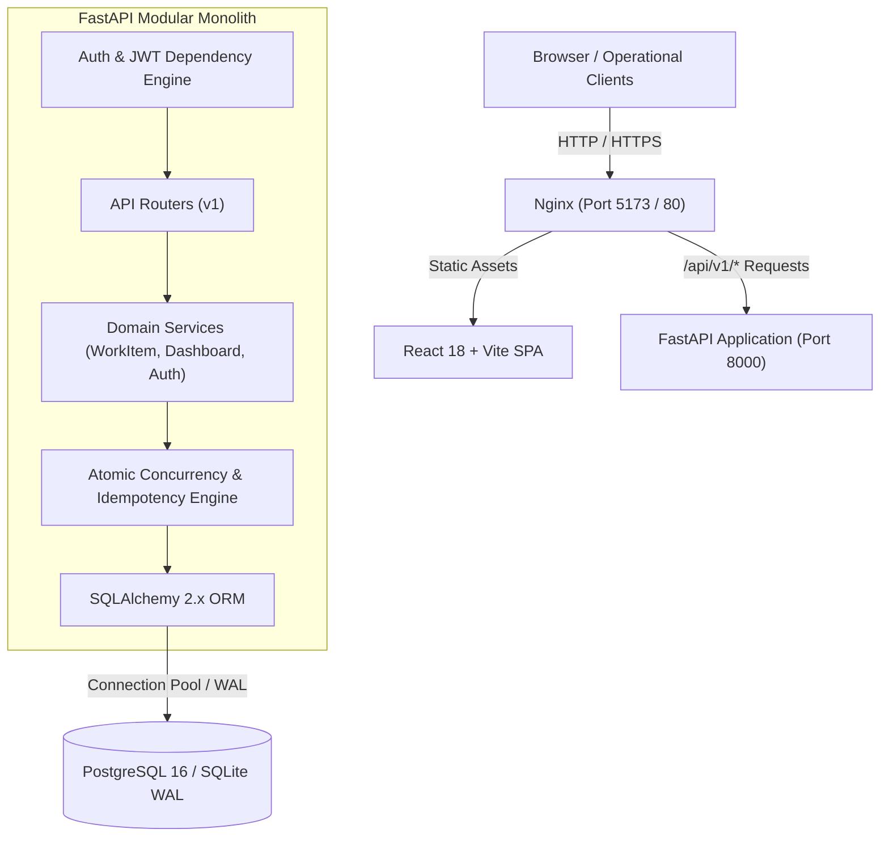
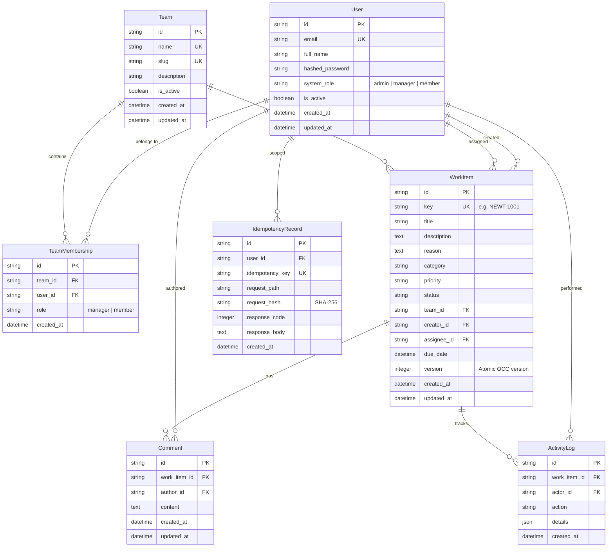
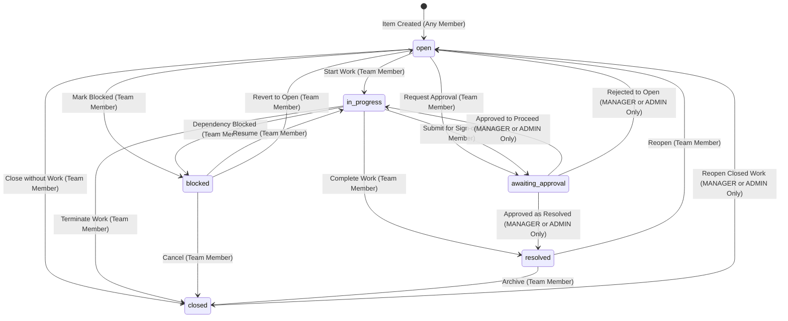
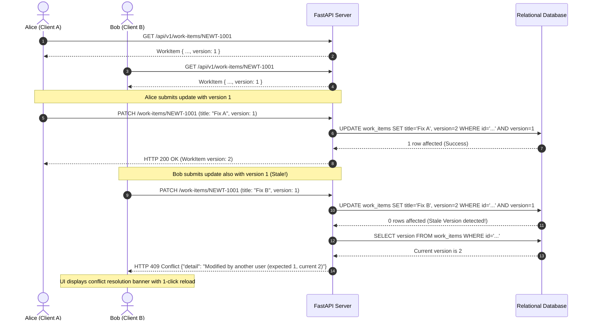
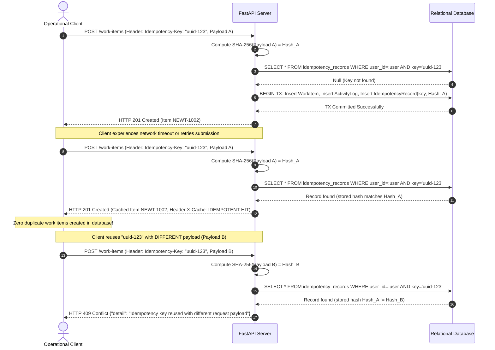

# Newtonite Operations — System Architecture

This document describes the architectural layout, component responsibilities, request flow, database relationships, authorization boundaries, and concurrency mechanisms of **Newtonite Operations**.

---

## 1. High-Level Architecture Diagram

---

## 2. Database Entity-Relationship Diagram (ERD)

---

## 3. Workflow & Approval State Machine

---

## 4. Sequence: Optimistic Concurrency Control (OCC)

---

## 5. Sequence: Idempotent Creation & Request Deduplication

---

## 6. Deployment Topology & Service Dependencies

- **PostgreSQL Database**: Healthy on port 5432 with persistent storage.
- **Backend API**: FastAPI container running behind health check `curl -f /api/v1/health`.
- **Frontend SPA**: Nginx container serving compiled static assets and proxying `/api/` upstream.
- **Local Fallback**: SQLite WAL mode with zero docker installation requirements.
